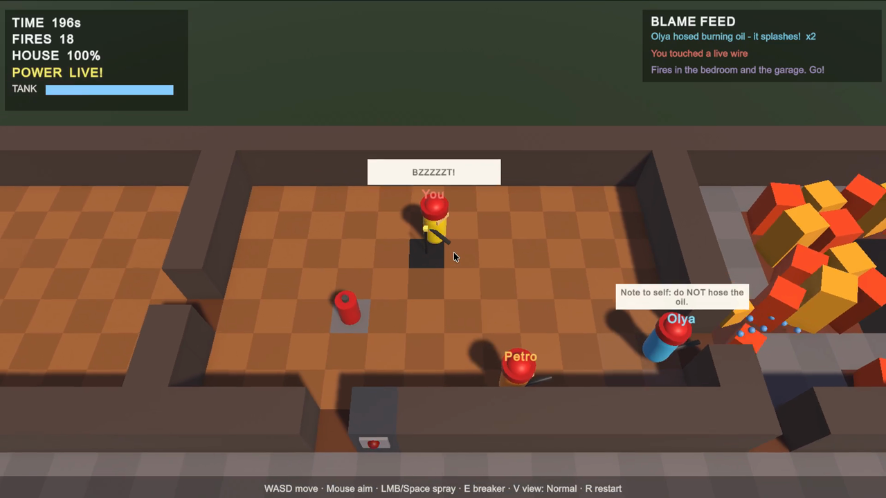
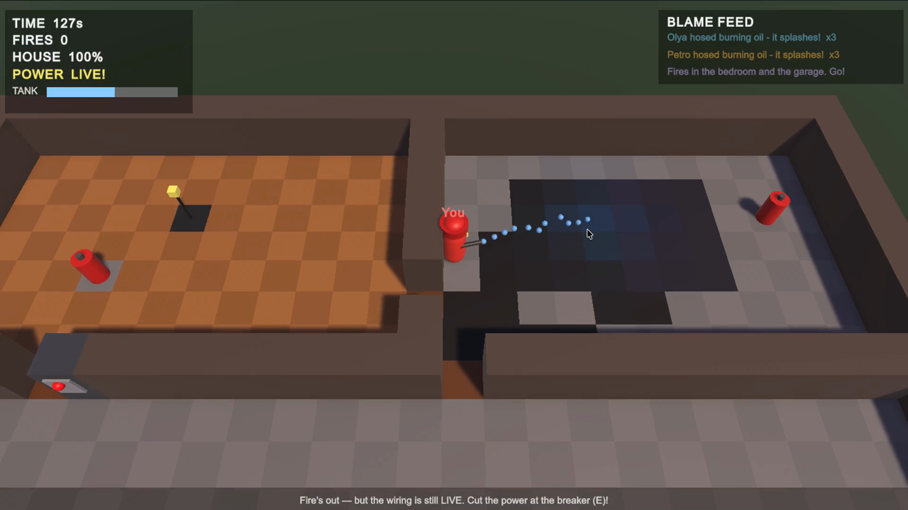
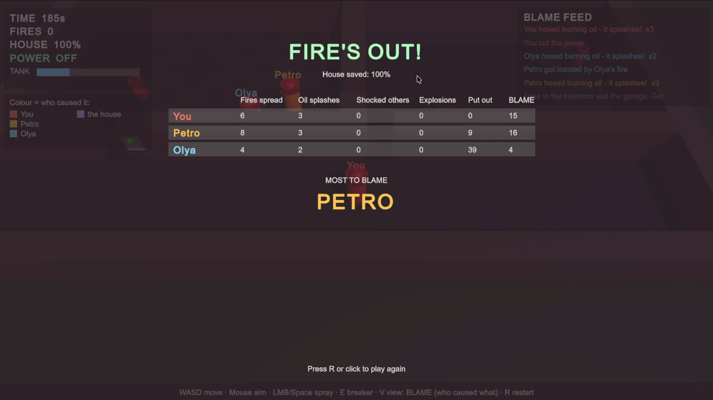

# Flame & Blame — Elemental Chaos

A systemic firefighting demo made in **Unity 6** for the *Flame and Blame Dev Contest* by RetroStyle Games.

Fire, water, steam, oil, gas and electricity are not separate effects — they live on one cellular grid and react to each other. And every fire and puddle remembers **who caused it**.

▶️ **Play in browser:** https://nisachunda.itch.io/flame-blame-elemental-chaos
🎬 **Video (≈5 min):** https://drive.google.com/file/d/1iTz8VRrvTaGF0V6XwFNYm4NWNdbvIqZ0/view?usp=drivesdk

## The system

| Interaction | What happens | Why it matters for the player |
|---|---|---|
| Water + wood fire | Fire goes out, **steam** appears | Steam blocks the view; AI teammates can't see fire through it |
| Water + burning oil | Oil **splashes** and spreads fire, even onto concrete | Don't hose the oil — contain it |
| Water + live wire | Connected puddles become **electrified** | Anyone stepping in gets shocked → cut the power first |
| Live wire | Sparks ignite nearby wood | The breaker is the first decision of the round |
| Fire + gas canister | **Explosion**, fire bursts around, firefighters knocked back | One mistake doubles the fire |
| Blame | Each fire/puddle stores its owner; spreading fire inherits it | Live "Blame feed" and end-of-round **Most to blame** board |

**AI teammates** (Petro & Olya) start clumsy — they hose oil and walk into electrified puddles — but learn: after a shock they avoid live puddles and run to the breaker; after splashing oil twice they stop spraying it.

## Controls

WASD — move · Mouse — aim · LMB / Space — spray · E — breaker · V — switch view (Normal / Blame / Electricity) · R — restart

Desktop only (keyboard + mouse).

## Tech

- **Cellular simulation** (`GridSim.cs`): 36×14 grid, 10 ticks/s. Each cell stores fire, fuel, water, steam, electricity and two owners (who lit it / whose water).
- Fire spreads to neighbours with probability based on intensity, flammability and wetness; new fire **inherits the owner** — that's how blame travels.
- Water and steam flow by diffusion; electricity is a **breadth-first search** from the wire through puddles above a threshold.
- AI teammates use BFS pathfinding on the same grid, line-of-sight checks and simple learning flags (`BotController.cs`).
- The whole level is built from a **text map** in code (`FlameBlameGame.cs`) — no hand-made scene. UI is IMGUI, so it works in WebGL with zero setup.
- Balance (fire speed, gas fuse) was tuned with headless simulation runs before building.

## Run it

1. Open the project in **Unity 6.6** (URP).
2. Press **Play** in any scene — the game bootstraps itself.

## AI usage

Built with Claude (Anthropic) as a development partner: simulation architecture, C# code, AI-teammate behaviour, balance checks, video script and editing. My part: choosing the idea, assembling the Unity project, building for WebGL, testing and deciding what stays.

---
*Flame and Blame is a game by RetroStyle Games. This is an independent contest entry.*
